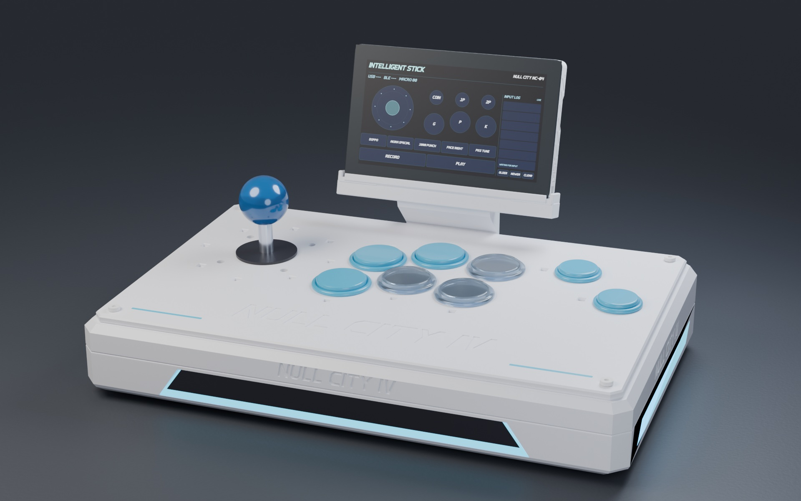
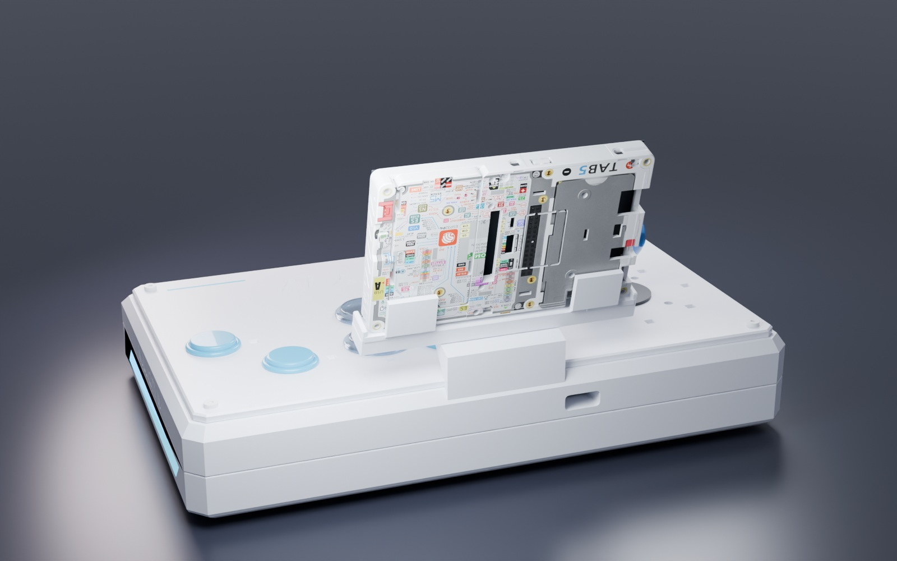
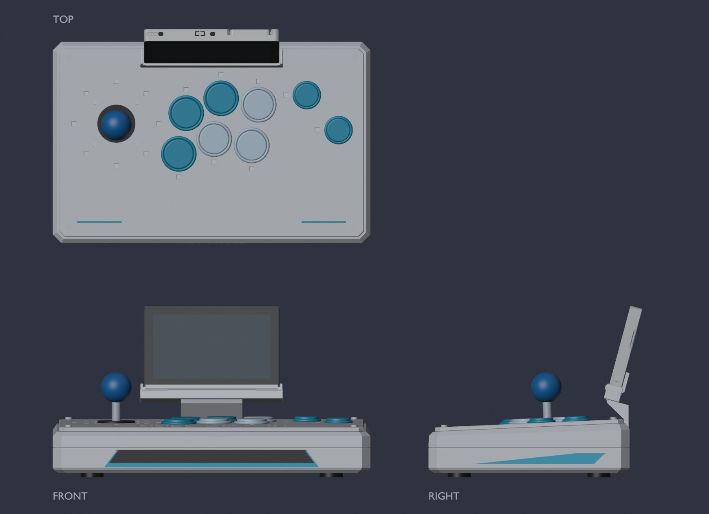
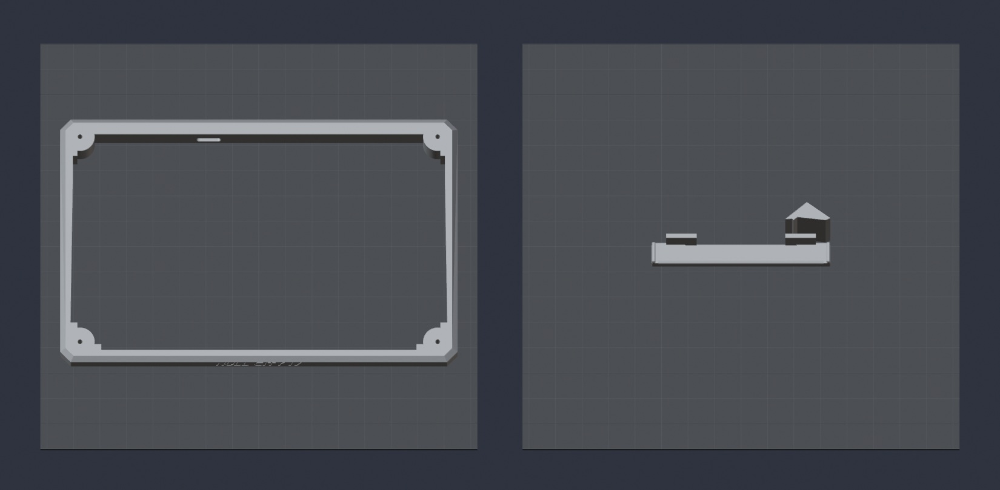

# NULL CITY IV / NC-04

NC-04は、M5Stack Tab5を15°後傾の固定受け皿に載せて使うアーケードスティックです。NC-03の300 × 190 mm筐体と6ボタン天板をベースに、Tab5の固定クレードルと、VF2向けのUSB・BLEジョイスティックを追加しました。



[3Dで見る](https://goroman.github.io/null-city-04/) · [Tab5に書き込む](firmware/README.md#ビルド書き込み) · [3Dプリント設定](PRINT_SETTINGS.md)

## 外観と三面図





## Tab5で遊ぶ

Tab5にファームウェアを書き込み、MacやPCにUSB-Cでつなぐか、Bluetooth設定で **NULL CITY NC-04** をペアリングします。ゲーム側で、使う方のコントローラーを割り当てます。macOSではUSBとBLEの両方でジョイスティックとして認識することを確認済みです。 [書き込みと接続の手順](firmware/README.md)

- **操作** — レバーは8方向。G・P・K・COIN・1Pは物理スイッチとタッチに対応し、2Pはタッチ専用です。
- **INPUT LOG** — 新しい入力が右のログ欄の下に入ります。方向は太い矢印、ボタンは丸で表示します。新しく押したボタンを塗りつぶしで表示します。ボタンを離すだけの入力や、レバーが中央へ戻るだけの動きは省きます。画面には7件、RAMには最大64件を保持します。
- **RECORD / PLAY** — レバーとG・P・Kの操作を1件記録して再生できます。COIN・1P・2Pは手動入力です。
- **VF2プリセット** — 独歩頂膝、崩撃雲身双虎掌、押している間だけの千本パンチをタッチ操作できます。 [各プリセットの使い方](firmware/README.md#vf2マクロプリセット)
- **USB Joy Check** — Chromeで軸とボタンの反応を確認できます。**Enter download mode** で、対応ファームウェアのTab5を書き込みモードへ切り替えられます。 [ローカル起動手順](firmware/README.md#macosでのusb入力チェック)


*Tab5実機のスクリーンショット。入力例を表示しています。*

### 物理スイッチを配線する

接続先は **Tab5背面の30ピンM5-Bus** です。各スイッチの **NO** を表の入力ピンへ、**COM** を共通GNDへつなぎます。入力は内部プルアップで、押すとLOWになります。コネクターのピン1と向きは実機と公式ピン表で照合してください。 [M5Stack公式ピン表](https://docs.m5stack.com/en/core/Tab5#pinmap)

| 入力 | M5-Busピン | ESP32-P4 GPIO | HID |
|---|---:|---:|---|
| 上 | 2 | 16 | Y− |
| 下 | 7 | 18 | Y＋ |
| 左 | 9 | 19 | X− |
| 右 | 11 | 5 | X＋ |
| G / GUARD | 19 | 3 | ボタン1 |
| P / PUNCH | 20 | 4 | ボタン2 |
| K / KICK | 21 | 2 | ボタン3 |
| COIN | 15 | 7 | ボタン4 |
| 1P / START | 16 | 6 | ボタン5 |
| 2P | — | — | ボタン6・タッチ専用 |
| 共通GND | 1、3、5のいずれか | — | — |

クレードルの底面は連続した面です。VF2用のハーネスは上のM5-Bus表に合わせて製作します。 [配線の詳細](firmware/README.md)

## 筐体を作る

H3Cで一式を新造する場合は、下ケース、上フレーム、天板、クレードル一式、脚、ライトカバーの6プレート構成です。本体はPLA、ライトカバーは乳白・半透明PLAを想定しています。 [造形配置を3Dで見る](https://goroman.github.io/null-city-04/) · [造形設定と見積もり](PRINT_SETTINGS.md)



*左は上フレーム、右はクレードルと接着用固定台。H3Cの330 × 320 mmプレートに、配布3MFの配置で表示しています。*

| 部品 | データと仕様 |
|---|---|
| 下ケース | [STL](STL/NC04_01_lower_tray.stl) · 床厚2.2 mm、水平な左右の照明帯 |
| 上フレーム | [STL](STL/NC04_02_upper_frame.stl) · [上フレーム3MF](print/h3c/NC04-fixed-frame-04-supertack.3mf) · 0.4 mm標準、約3時間5分 |
| 天板 | [STL](STL/NC04_03_control_panel.stl) · 288 × 178 × 4 mm、6ボタン配列、4 × 4 mmのLED角穴16個、凹彫りロゴ |
| クレードルと固定台 | [同一プレートの3MF](print/h3c/NC04-fixed-cradle-04-supertack.3mf) · 白PLA、約1時間3分 · [受け皿STL](STL/NC04_04_tab5_cradle.stl) · [固定台STL](STL/NC04_12_fixed_cradle_mount.stl) |
| ライトカバー | [左](STL/NC04_06_light_left_diffuser.stl) · [右](STL/NC04_06_light_right_diffuser.stl) · [照明構成](LIGHTING.md) |

固定台はクレードルと同じプレートで印刷する別部品です。固定台を上フレームの後端中央に接着し、Tab5を後傾15°で固定します。

### 組み立て

1. 固定台の下側を上フレーム後端の輪郭に合わせて接着し、受け皿を固定台上面の傾斜に合わせて接着します。
2. Tab5を受け皿に載せ、背面の平らな2か所を薄い両面テープで固定します。CAD上のすき間は約0.6〜0.8 mmです。

[Blenderモデル](NULL_CITY_NC04.blend) · [MuJoCoの固定配置モデル](simulation/nc04-fixed-cradle.xml)

## NC-03から流用する

レバー、ボタン、脚、前面ライトカバーを流用できます。既存の下ケースと天板で仮組みするなら、NC-04の上フレームとクレードル一式の2プレートから始められます。左右の照明帯を水平にそろえる場合は、NC-04の下ケースと左右カバーを使います。NC-03の下ケースにM3 × 40 mmねじを使う場合は、穴底までの深さを確認してください。 [NC-03の実機写真](docs/images/nc03-built.jpg) · [NC-03リポジトリ](https://github.com/GOROman/null-city)

## 設計資料

- **3Dビューアー** — 外観、分解、H3Cの造形配置を確認できます。Z／X／C／V／Bで視点、スペースで組立・分解を切り替えます。 [3Dビューアー](https://goroman.github.io/null-city-04/) · [操作と開発手順](web/README.md)
- **部品と寸法** — [機構BOM](BOM.md) · [メーカー寸法図](docs/references/README.md) · [レバーの嵌合記録](docs/fit/README.md) · [開発日記](docs/development-diary.md)
- **NC-03の製作データ** — [6プレート3MF](print/h3c/NC03_H3C_6plates_lighting_sliced.3mf) · [3色天板](print/h3c/PANEL_MULTICOLOR.md) · [デカールとカット手順](artwork/decal/README.md) · [試作基板のKiCadデータ](hardware/nc03-controller/README.md)
- **NULL FONT** — [フォントパッケージ](fonts/null-font/) · [ベクターロゴ](artwork/logo/null-city.svg)

NC-04のBlenderモデル、部品STL、レンダーはリポジトリ直下から再生成できます。

```sh
blender --background --factory-startup --python-exit-code 1 --python NULL_CITY_NC04.py
blender --background NULL_CITY_NC04.blend --python-exit-code 1 --python scripts/render_nc04_readme.py
```

## ライセンス

Copyright © 2026 GOROman。スクリプトは [MIT](LICENSES/MIT.txt)、造形データ・オリジナル画像・ドキュメントは [CC BY 4.0](LICENSES/CC-BY-4.0.txt)、NULL FONTは [SIL OFL 1.1](fonts/null-font/OFL.txt) です。メーカー資料など第三者素材の扱いは [LICENSE](LICENSE) を参照してください。
