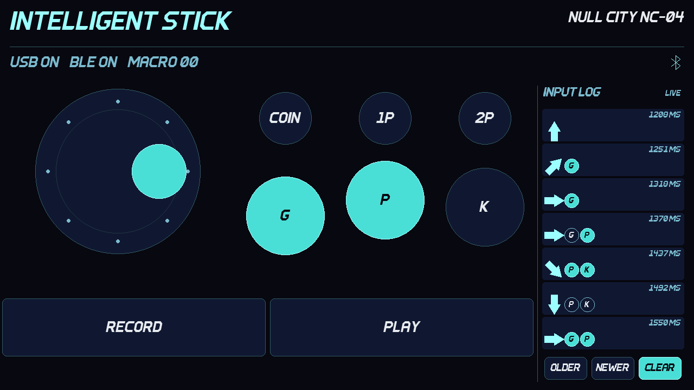

# NULL CITY IV / NC-04

NC-04は、M5Stack Tab5を差し込んで使うアーケードスティックです。NC-03の300 × 190 mm筐体と6ボタン天板をベースに、Tab5のチルト機構と、VF2向けのUSB・BLEジョイスティックを追加しました。


[3Dで見る](https://goroman.github.io/null-city-04/) · [Tab5に書き込む](firmware/README.md#ビルド書き込み) · [3Dプリント設定](PRINT_SETTINGS.md) · [背面レンダー](preview-nc04-rear.jpg)

## Tab5で遊ぶ

Tab5にファームウェアを書き込み、MacやPCにUSB-Cでつなぐか、Bluetooth設定で **NULL CITY NC-04** をペアリングします。ゲーム側で、使う方のコントローラーを割り当てます。macOSではUSBとBLEの両方でジョイスティックとして認識することを確認済みです。 [書き込みと接続の手順](firmware/README.md)

- **操作** — レバーは8方向。G・P・K・COIN・1Pは物理スイッチとタッチに対応し、2Pはタッチ専用です。
- **INPUT LOG** — 新しい入力が右のログ欄の下に入ります。方向は太い矢印、ボタンは丸で表示します。押下中は塗りつぶし、解放は輪郭だけ。レバーが中央へ戻るだけの動きは省きます。画面には7件、RAMには最大64件を保持します。
- **RECORD / PLAY** — レバーとG・P・Kの操作を1件記録して再生できます。COIN・1P・2Pは手動入力です。
- **VF2プリセット** — 独歩頂膝、崩撃雲身双虎掌、押している間だけの千本パンチをタッチ操作できます。 [各プリセットの使い方](firmware/README.md#vf2マクロプリセット)
- **USB Joy Check** — Chromeで軸とボタンの反応を確認できます。**Enter download mode** で、対応ファームウェアのTab5を書き込みモードへ切り替えられます。 [ローカル起動手順](firmware/README.md#macosでのusb入力チェック)



*Tab5実機のスクリーンショット。入力例を表示しています。*

### 物理スイッチを配線する

接続先は **Tab5背面の30ピンM5-Bus** です。各スイッチの **NO** を表の入力ピンへ、**COM** を共通GNDへつなぎます。入力は内部プルアップで、押すとLOWになります。コネクターのピン1と向きは実機と公式ピン表で照合してください。 [M5Stack公式ピン表](https://docs.m5stack.com/en/core/Tab5#pinmap)

| 入力 | M5-Busピン | ESP32-P4 GPIO | HID |
|---|---:|---:|---|
| 上 | 2 | 16 | Y− |
| 下 | 7 | 18 | Y＋ |
| 左 | 9 | 19 | X− |
| 右 | 11 | 5 | X＋ |
| G / GUARD | 19 | 3 | ボタン1 |
| P / PUNCH | 20 | 4 | ボタン2 |
| K / KICK | 21 | 2 | ボタン3 |
| COIN | 15 | 7 | ボタン4 |
| 1P / START | 16 | 6 | ボタン5 |
| 2P | — | — | ボタン6・タッチ専用 |
| 共通GND | 1、3、5のいずれか | — | — |

クレードルのCADには、下辺の **2×5 Ext.Port1** 用の開口とフラットケーブル経路があります。VF2用のハーネスは上のM5-Bus表に合わせて製作し、Tab5を傾けたときのコネクターとケーブルの逃げを確認します。 [配線の詳細](firmware/README.md) · [Ext.Port1の資料](https://docs.m5stack.com/en/tab5/Tab5_Keyboard)

## 筐体を作る

H3Cで一式を新造する場合は、下ケース、上フレーム、天板、クレードル一式、脚、ライトカバーの6プレート構成です。本体はPLA、ライトカバーは乳白・半透明PLAを想定しています。 [造形配置を3Dで見る](https://goroman.github.io/null-city-04/) · [造形設定と見積もり](PRINT_SETTINGS.md)

| 部品 | データと仕様 |
|---|---|
| 下ケース | [STL](STL/NC04_01_lower_tray.stl) · 床厚2.2 mm、水平な左右の照明帯 |
| 上フレーム | [STL](STL/NC04_02_upper_frame.stl) · [H3C用3MF](print/h3c/NC04-upper-frame-supertack.3mf) · SuperTack、0.8 mm高流量、積層0.32 mm、準備込み約1時間4分 |
| 天板 | [STL](STL/NC04_03_control_panel.stl) · 288 × 178 × 4 mm、6ボタン配列、4 × 4 mmのLED角穴16個、凹彫りロゴ |
| クレードル一式 | [H3C用3MF](print/h3c/NC04-cradle-04-supertack.3mf) · 9点、SuperTack、0.4 mm標準、積層0.20 mm、準備込み約1時間 |
| クレードル一式の個別STL | [クレードル](STL/NC04_04_tab5_cradle.stl) ×1、[ガイド](STL/NC04_05_tab5_snap_guide.stl)・[軸受け](STL/NC04_09_hinge_snap_bearing.stl)・[軸ピン](STL/NC04_07_hinge_snap_pin.stl)・[Cクリップ](STL/NC04_08_hinge_c_clip.stl) 各×2 |
| ライトカバー | [左](STL/NC04_06_light_left_diffuser.stl) · [右](STL/NC04_06_light_right_diffuser.stl) · [照明構成](LIGHTING.md) |

上フレームは造形完了を確認済みです。クレードル一式はH3Cで造形準備まで確認しました。下ケースの実機造形、クレードルの完成と嵌合、配線した状態でのチルトは未確認です。

### 組み立て

1. 上フレーム左右の穴に軸受けを差し込みます。外すときは背面の解除窓から爪を押します。
2. クレードルを軸受けの間に置き、左右から **Ø6 mmの軸ピン** を差してCクリップで抜け止めします。左右のスナップガイドを取り付けます。
3. Tab5を上からガイドに差し込み、下端を受け棚に載せます。背面の純正M3インサート2か所へ、**M3 × 8 mmのステンレスねじと平ワッシャー** で固定します。ワッシャーの設計値は外径7 mm・厚さ0.5 mmです。ねじの底付きを現物で確認します。
4. 天板は **M3 × 40 mmねじ4本** で、下ケース四隅のM3熱圧入インサートに固定します。

Blenderのフレーム1〜3で、垂直から後方へ15°・30°・45°の姿勢を確認できます。45°ではTab5が筐体後端から約50 mm張り出します。 [Blenderモデル](NULL_CITY_NC04.blend) · [メーカーCAD](docs/references/tab5/) · [スナップ構造の参考](https://github.com/GOROman/stackchan-strider#組み立て)

### NC-03から流用する

レバー、ボタン、脚、前面ライトカバーを流用できます。既存の下ケースと天板で仮組みするなら、NC-04の上フレームとクレードル一式の2プレートから始められます。左右の照明帯を水平にそろえる場合は、NC-04の下ケースと左右カバーを使います。NC-03の下ケースにM3 × 40 mmねじを使う場合は、穴底までの深さを確認してください。 [NC-03の実機写真](docs/images/nc03-built.jpg) · [NC-03リポジトリ](https://github.com/GOROman/null-city)

## 設計資料

- **3Dビューアー** — 外観、分解、H3Cの造形配置を確認できます。Z／X／C／V／Bで視点、スペースで組立・分解を切り替えます。 [3Dビューアー](https://goroman.github.io/null-city-04/) · [操作と開発手順](web/README.md)
- **部品と寸法** — [機構BOM](BOM.md) · [メーカー寸法図](docs/references/README.md) · [レバーの嵌合記録](docs/fit/README.md) · [開発日記](docs/development-diary.md)
- **NC-03の製作データ** — [6プレート3MF](print/h3c/NC03_H3C_6plates_lighting_sliced.3mf) · [3色天板](print/h3c/PANEL_MULTICOLOR.md) · [デカールとカット手順](artwork/decal/README.md) · [試作基板のKiCadデータ](hardware/nc03-controller/README.md)
- **NULL FONT** — [フォントパッケージ](fonts/null-font/) · [ベクターロゴ](artwork/logo/null-city.svg)

NC-04のBlenderモデル、部品STL、レンダーはリポジトリ直下から再生成できます。

```sh
blender --background --factory-startup --python-exit-code 1 --python NULL_CITY_NC04.py
```

## ライセンス

Copyright © 2026 GOROman。スクリプトは [MIT](LICENSES/MIT.txt)、造形データ・オリジナル画像・ドキュメントは [CC BY 4.0](LICENSES/CC-BY-4.0.txt)、NULL FONTは [SIL OFL 1.1](fonts/null-font/OFL.txt) です。メーカー資料など第三者素材の扱いは [LICENSE](LICENSE) を参照してください。
